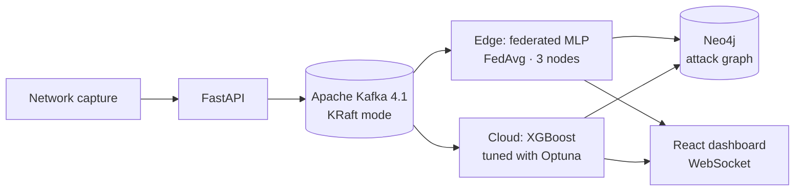
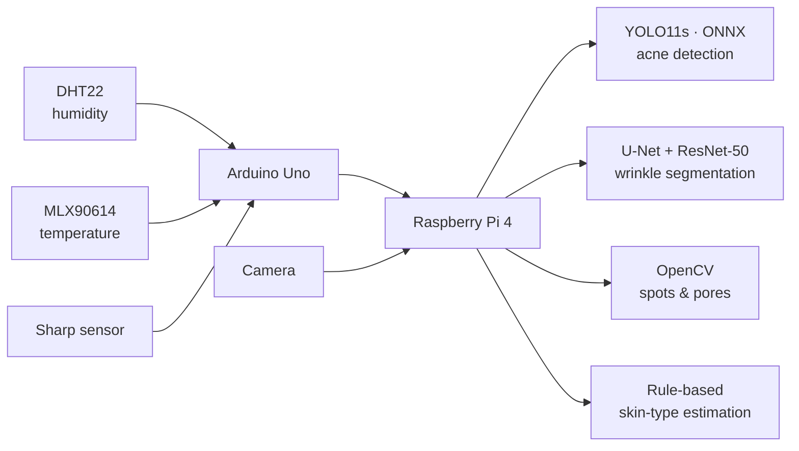

 

---

## 👋 About

MSc student in **Artificial Intelligence & Digital Computing** at FST Béni Mellal. I work across the full ML lifecycle: **designing, training and rigorously evaluating models** (CNN, LSTM, XGBoost, Transformer fine-tuning), building the **data pipelines** around them, and wrapping them in **working demos** (Flask, Gradio, React dashboards, embedded hardware).

Areas I work in: `Audio` · `Computer Vision` · `Transformers` · `Federated Learning` · `Information Retrieval` · `Real-time Data` · `Edge / IoT`

> 🎯 **Looking for:** a PFE end-of-studies internship in AI & Data (2027).

---

## 🚀 Projects

### 🎙️ Speech Emotion Recognition — Wav2Vec2 vs CNN vs LSTM
Comparative study of deep-learning architectures for emotion classification on the **RAVDESS** audio corpus.

| Approach | Input representation |
|---|---|
| 2D CNN | Mel spectrograms |
| LSTM | MFCC sequences |
| **Wav2Vec2 fine-tuning** | Raw waveform |

- Feature-extraction pipeline with **Librosa** (Mel spectrograms, MFCC)
- Strict experimental protocol: **stratified split**, same data for every model
- Interactive **Gradio** demo for real-time inference

`PyTorch` `TensorFlow/Keras` `HuggingFace Transformers` `Librosa` `Gradio`

---

### 🌐 NIDS-FL — Federated Learning Network Intrusion Detection
Distributed intrusion-detection system combining **Apache Kafka** and **Federated Learning**: models are trained where the data lives.

<b>📐 Architecture</b>

- Real-time architecture on **Kafka 4.1 (KRaft)** with fully decoupled services (FastAPI, capture, pipeline)
- **FedAvg** training across 3 distributed nodes through Kafka; binary classification with a federated MLP
- **XGBoost** optimised with **Optuna**; hybrid **Edge/Cloud** pipeline (MLP + XGBoost) to save bandwidth
- **Neo4j** attack-graph visualisation and a real-time **React** supervision dashboard

`Apache Kafka` `Federated Learning` `XGBoost` `Optuna` `Neo4j` `FastAPI` `React` `Docker`

---

### 🫁 COVID-19 & Pneumonia Detection — Chest X-rays
Deep-learning classification of medical images (3 classes) for diagnostic support.

- Preprocessing and ingestion pipeline for a large chest X-ray dataset, **stratified train/val/test split**
- Two architectures compared: **EfficientNetB0** (ImageNet transfer learning + fine-tuning) vs a **custom sequential CNN**
- Evaluation with **confusion matrices** and classification reports (precision, recall, F1)
- 💡 **Takeaway:** a simple, domain-adapted architecture outperformed the complex pre-trained model

`TensorFlow/Keras` `EfficientNetB0` `OpenCV` `scikit-learn`

---

### 🧴 SmartSkinAnalyzer — IoT & AI skin analysis
Embedded prototype combining IoT sensors and computer vision.

<b>📐 Architecture</b>

- **Acne detection:** YOLO11s trained on ACNE04, exported to **ONNX** for optimised embedded inference
- **Wrinkle segmentation:** U-Net with a ResNet-50 encoder on FFHQ-Wrinkle
- **Spots / pores:** OpenCV image processing; skin type estimated by a rule-based system on temperature and humidity

`PyTorch` `YOLO11s` `U-Net` `ONNX Runtime` `OpenCV` `Arduino` `Raspberry Pi 4`

---

### 🔎 ResearchWatch — Scientific Search Engine
Complete scientific search system on the **Elastic stack**, with an ingestion pipeline and an analytics dashboard.

- **Ingestion:** collection and indexing of arXiv articles with Python, containerised with Docker
- **Custom bilingual (EN/FR) analyzer** with synonym handling (AI, ML, NLP) and asciifolding filters
- **8 types of DSL queries** (full-text, function score, autocomplete, aggregations) and an interactive **Kibana** dashboard
- Automated **pytest** suite covering analyzers and aggregations

`Elasticsearch` `Kibana` `Python` `Docker` `arXiv API`

---

## 💼 Experience

**Web Developer Intern — Scientific research application** · *Ménara Préfa* · 2 months, 2025

- Web application for searching indexed scientific publications
- **Scopus** and **SCImago** API integration for bibliometric search
- Automated **PDF and Excel** report generation · Flask backend, scientific data processing

`Python` `Flask` `HTML/CSS` `JavaScript`

---

## 🛠️ Tech stack

| | |
|---|---|
| **Languages** | Python · Java · C · C# · JavaScript · SQL (T-SQL, PL/SQL) |
| **ML & Deep Learning** | PyTorch · TensorFlow/Keras · HuggingFace Transformers · scikit-learn · XGBoost · Federated Learning · Reinforcement Learning |
| **Audio & Vision** | Wav2Vec2 · Librosa · OpenCV · CNN · LSTM · EfficientNet |
| **Data & Search** | Elasticsearch · Kibana · Apache Kafka · Neo4j · SQL · NoSQL |
| **Web & Desktop** | Flask · Gradio · Java EE · .NET (ADO.NET) · HTML · CSS |
| **IoT & Edge** | Raspberry Pi · Arduino |
| **Tools** | Git/GitHub · Docker · Google Colab · TensorBoard |

  
  
  
  
  
  
  
  
  
  
  
  

---

## 🎓 Education

| Degree | Institution | Period |
|---|---|---|
| **MSc — Artificial Intelligence & Digital Computing (AIDC)** | FST Béni Mellal | Since Sept. 2025 |
| **BSc — Science & Technology (Computer Science)** | FST Béni Mellal | 2024 – 2025 |
| **DEUST — Mathematics, Computer Science, Physics** | FST Béni Mellal | 2022 – 2024 |

**Languages:** Arabic (native) · French (good) · English (intermediate, technical)

**Interests:** Artificial Intelligence · Generative AI (LLMs, RAG) · Data Science · Web Development

---

**Open to a PFE internship in AI & Data — 2027**

📧 [elazaarhamza5@gmail.com](mailto:elazaarhamza5@gmail.com) · 💼 [LinkedIn](https://linkedin.com/in/hamzaelazaar)

